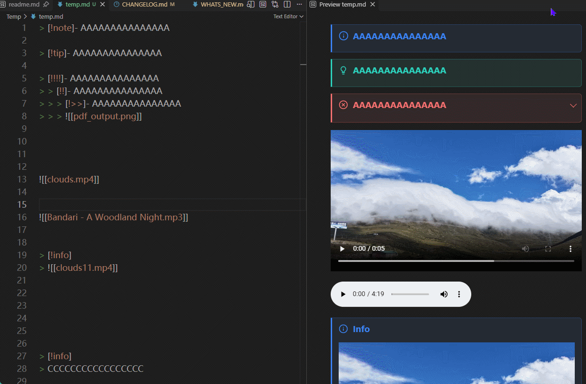

# CallOuts

## ⚙ Disable GitHub-only mode and enable callout aliases by default.
Not all markdown doc will fit to github-only mode, so this change enables callout aliases by default for better compatibility.

## ↑ [Callouts] Only show the collapse arrow when the callout has content below its title.
So you can easily see which callouts have additional content to expand.

