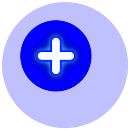
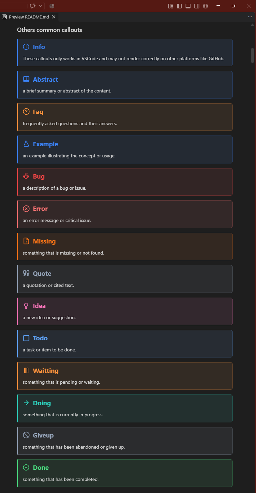
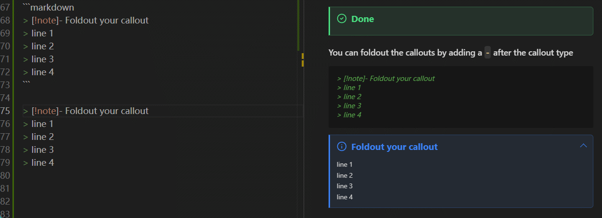
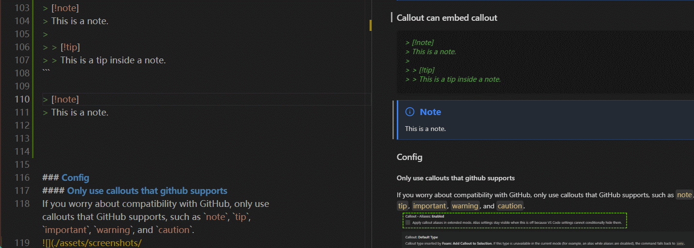
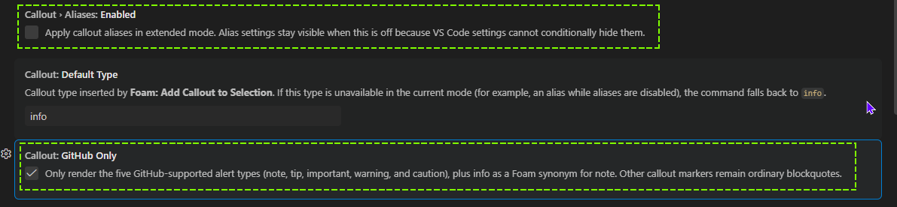
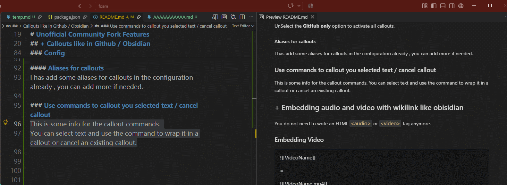
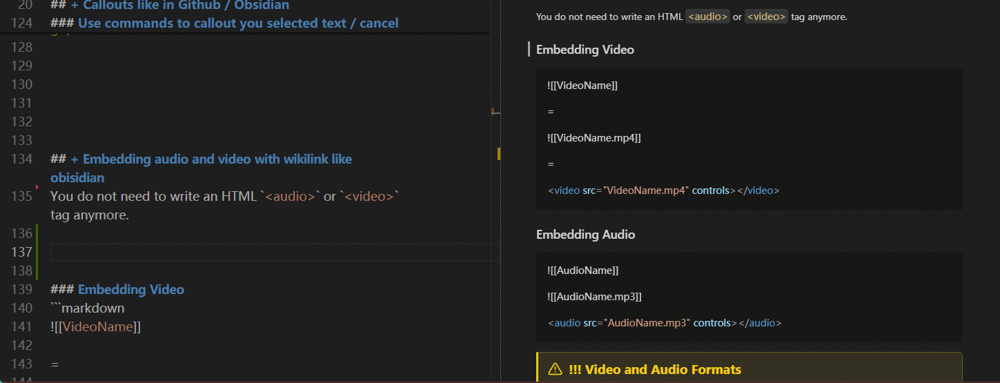
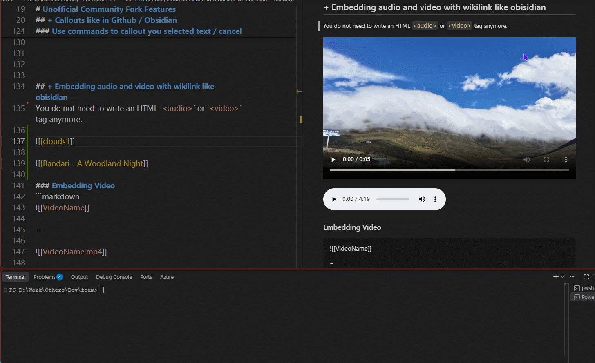
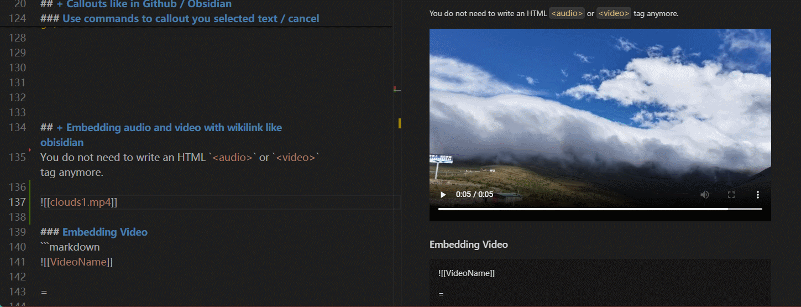

<div align="center">

</div>


# Foam - Unofficial Community Fork
Add some useful features to the original Foam extension.

> [!info] **Unofficial fork:** This repository builds on [Foam](https://github.com/foambubble/foam)
the open-source knowledge-management extension for VS Code. 
It is maintained independently and is not an official Foam release.

## With gratitude to the original Foam team

To Jani Eväkallio, the original creator, and to every maintainer and contributor who has shaped Foam: thank you. Your thoughtful work on the code, documentation, and community created the foundation this fork is built on. This fork is an independent continuation for additional ideas; it does not diminish or replace the original project. The original project description and contributor credits are preserved below.

# Unofficial Community Fork Features
## + Callouts like in Github / Obsidian
### Github Callouts
> [!note]
> notes for something.

> [!tip]
> tips for somethings.

> [!important]
> some important information.

> [!warning]
> warning for something.

> [!caution]
> be careful with this.

### Others common callouts 
> [!warning]
> These callouts only works in VSCode and may not render correctly on other platforms like GitHub.\
> 

```markdown
> [!abstract] 
> a brief summary or abstract of the content.


> [!faq]
> frequently asked questions and their answers.

> [!example]
> an example illustrating the concept or usage.

> [!bug]
> a description of a bug or issue.

> [!error]
> an error message or critical issue.

> [!missing]
> something that is missing or not found.

> [!quote]
> a quotation or cited text.

> [!idea]
> a new idea or suggestion.

> [!todo]
> a task or item to be done.

> [!waitting]
> something that is pending or waiting.

> [!doing]
> something that is currently in progress.

> [!giveup]
> something that has been abandoned or given up.

> [!done]
> something that has been completed.
```

### You can foldout the callouts by adding a `-` after the callout type
```markdown
> [!note]- Foldout your callout
> line 1
> line 2
> line 3
> line 4
```


> [!note]- Foldout your callout
> line 1
> line 2
> line 3
> line 4

### Callout can embed callout
```markdown
> [!note]
> This is a note.
>
> > [!tip]
> > This is a tip inside a note.
```



### Config 
#### Only use callouts that github supports
If you worry about compatibility with GitHub, only use callouts that GitHub supports, such as `note`, `tip`, `important`, `warning`, and `caution`.


#### Active all callouts
UnSelect the **GitHub only** option to activate all callouts.

#### Aliases for callouts
I has add some aliases for callouts in the configuration already , you can add more if needed.

### Use commands to callout you selected text / cancel callout
This is some info for the callout commands. 
You can select text and use the command to wrap it in a callout or cancel an existing callout.



## + Embedding audio and video with wikilink like obisidian
You do not need to write an HTML `<audio>` or `<video>` tag anymore.

### Embedding Video

```markdown
![[VideoName]]

= 

![[VideoName.mp4]]

=

<video src="VideoName.mp4" controls></video>
```

> [!warning] !!! Video and Audio Formats
> Video formats: `.mp4`, `.webm`, `.avi`, `.mov`. Audio formats: `.mp3`, `.wav`, `.m4a`.

> [VSCode don't support all video and audio formats natively. ](https://github.com/microsoft/vscode/issues/167685)

> Make sure your media files are in a format that VSCode can play.

> [!info] Maybe ffmpeg can help convert your media files to a compatible format.
> ```powershell
> ffmpeg -i "D:\YourVideo.mp4" -c:v copy -c:a libmp3lame -b:a 192k "D:\YourVideoExportName.mp4"
> ```
> 

### Embedding Audio

```markdown
![[AudioName]]

![[AudioName.mp3]]

<audio src="AudioName.mp3" controls></audio>
```
---


# Foam for VSCode

[](https://marketplace.visualstudio.com/items?itemName=foam.foam-vscode)
[](https://marketplace.visualstudio.com/items?itemName=foam.foam-vscode)
[](https://marketplace.visualstudio.com/items?itemName=foam.foam-vscode)
[](https://marketplace.visualstudio.com/items?itemName=foam.foam-vscode)
[](https://discord.com/invite/HV2tn2FpEk)

</div>

[Foam](https://foam.md) is a note-taking tool that lives within VS Code, which means you can pair it with your favorite extensions for a great editing experience.

Foam is open source, and allows you to create a local first, markdown based, personal knowledge base. You can also use it to publish your notes.

Foam is also meant to be extensible, so you can integrate with its internals to customize your knowledge base.

## Features

### Graph Visualization

See how your notes are connected via a [graph](https://docs.foam.md/features/graph-view/) with the `Foam: Show Graph` command.


### Foam Queries

Embed dynamic, auto-updating lists, tables, and counts of notes directly in the Markdown preview using `foam-query` and `foam-query-js` code blocks.
See the [Foam Queries documentation](https://docs.foam.md/features/foam-queries/) for the full reference.


### Block IDs

Link or embed specific paragraphs, list items, headings, and blockquotes within a note using `[[note#^blockid]]` syntax.
Add a `^id` marker to any block element, then reference it from anywhere in your knowledge base.


### Note embed

Embed the content from other notes. Embed entire notes, sections or even just blocks.


### Link Autocompletion

Foam helps you create the connections between your notes, and your placeholders as well.


### Sync links on file rename

Foam updates the links to renamed files, so your notes stay consistent.


### Unique identifiers across directories

Foam supports files with the same name in multiple directories.
It will use the minimum identifier required, and even report and help you fix existing ambiguous wikilinks.


### Link Preview and Navigation


### Go to definition, Peek References

See where a note is being referenced in your knowledge base.


### Navigation in Preview

Navigate your rendered notes in the VS Code preview panel.


### Support for sections

Foam supports autocompletion, navigation, embedding and diagnostics for note sections.
Just use the standard wiki syntax of `[[resource#Section Title]]`.

### Link Alias

Foam supports link aliasing, so you can have a `[[wikilink]]`, or a `[[wikilink|alias]]`.

### Templates

Use [custom templates](https://docs.foam.md/features/templates/) to have avoid repetitve work on your notes.


### Backlinks Panel

Quickly check which notes are referencing the currently active note.
See for each occurrence the context in which it lives, as well as a preview of the note.


### Tag Explorer Panel

Tag your notes and navigate them with the [Tag Explorer](https://docs.foam.md/features/tags/).
Foam also supports hierarchical tags.


### Orphans and Placeholder Panels

Orphans are note that have no inbound nor outbound links.
Placeholders are dangling links, or notes without content.
Keep them under control, and your knowledge base in better state, by using this panel.


### Syntax highlight

Foam highlights wikilinks and placeholder differently, to help you visualize your knowledge base.


### Daily note

Create a journal with [daily notes](https://docs.foam.md/features/daily-notes/).


### Generate references for your wikilinks

Create markdown [references](https://docs.foam.md/features/link-reference-definitions/) for `[[wikilinks]]`, to use your notes in a non-Foam workspace.
With references you can also make your notes navigable both in GitHub UI as well as GitHub Pages.


### Commands

- Explore your knowledge base with the `Foam: Open Random Note` command
- Access your daily note with the `Foam: Open Daily Note` command
- Create a new note with the `Foam: Create New Note` command
  - This becomes very powerful when combined with [note templates](https://docs.foam.md/features/templates/) and the `Foam: Create New Note from Template` command
- See your workspace as a connected graph with the `Foam: Show Graph` command
- And many [more](https://docs.foam.md/features/commands/)

## Recipes

People use Foam in different ways for different use cases, check out the [recipes](https://docs.foam.md/recipes/recipes/) page for inspiration!

## Getting started

> Already using Obsidian? An Obsidian vault is usually already a Foam workspace — see [Coming from Obsidian](https://docs.foam.md/recipes/migrating-from-obsidian/).

You really, _really_, **really** should read [Foam documentation](https://foam.md), but if you can't be bothered, this is how to get started:

1. [Create a GitHub repository from foam-template](https://github.com/foambubble/foam-template/generate). If you want to keep your thoughts to yourself, remember to set the repository private.
2. Clone the repository and open it in VS Code.
3. When prompted to install recommended extensions, click **Install all** (or **Show Recommendations** if you want to review and install them one by one).

This will also install `Foam`, but if you already have it installed, that's ok, just make sure you're up to date on the latest version.

## Known Issues

See the [issues](https://github.com/foambubble/foam/issues/) on our GitHub repo ;)

## Release Notes

See the [CHANGELOG](CHANGELOG.md).
